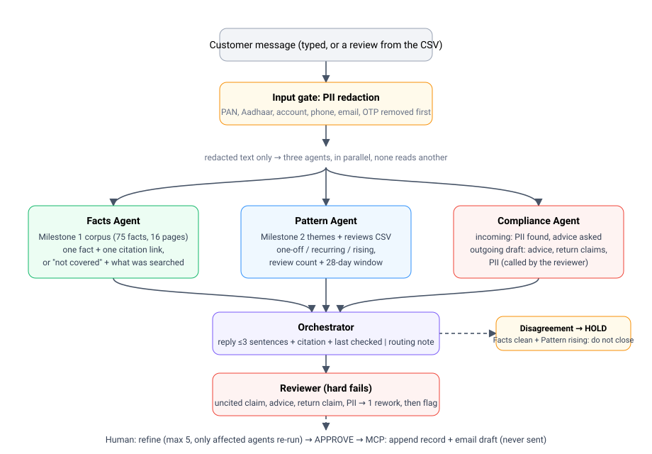
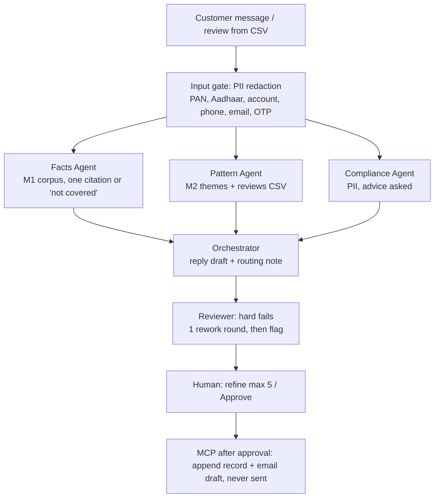

# Multi-Agent Support Desk (Milestone 3)

Product: **Groww**, with **HDFC Mutual Fund** schemes (same as Milestones 1 and 2).

A customer question or complaint goes in. Three specialist agents run in parallel, an orchestrator merges them into a **reply draft** (3 sentences or fewer, facts-only, one citation link, "last checked" date) and an **internal routing note**. A reviewer blocks anything that breaks the facts-only rule before a human sees it. Nothing is saved or drafted until a human clicks Approve.





## Files
| File | Purpose |
|---|---|
| `app.py`, `templates/` | Flask UI: submit, three agent cards, reply + routing note, reviewer, refine, approve |
| `desk.py` | input gate, parallel stage, orchestrate/review/rework loop, refinement router, logging |
| `agents.py` | Facts, Pattern, Compliance agents + output schemas |
| `orchestrator.py`, `reviewer.py` | reply + routing note; hard-fail checks |
| `corpus.py`, `corpus_registry.py` | Milestone 1 corpus, citations, retrieval |
| `pipeline.py`, `data/reviews.csv` | Milestone 2 themes and reviews |
| `mcp_layer.py` | Milestone 2 approval gate, record append, email draft |
| `pii.py`, `llm.py`, `config.py`, `eval_set.py` | redaction, optional Groq client, settings, test inputs |
| `run_eval.py`, `tests/` | evidence generator, unit tests |
| `outputs/evidence/` | batch, branch, advice, refinement and gate evidence |
| `SOURCES.md` | every public source used |
| `render.yaml` | optional free deploy on Render |

## Run it
```bash
pip install -r requirements.txt
python app.py                      # http://localhost:5000
python run_eval.py                 # regenerates outputs/evidence/*
python -m unittest discover -s tests -v
```
No API key is needed. Optional: copy `.env.example` to `.env`, add `GROQ_API_KEY`, and the orchestrator can rephrase the reply while the reviewer and compliance agent add an LLM check on top of the rules (see Limitations).

## The three agents (`agents.py`)
| Agent | Input | Returns |
|---|---|---|
| **Facts** | redacted message | `covered` + one fact + **one** citation URL, or `not_covered` + what it searched. No general-knowledge fallback. |
| **Pattern** | redacted message | `one-off / recurring / rising`, number of similar 1-3★ reviews, the window (28 days, split 14 / 14), theme. Reuses `pipeline.py` from Milestone 2 (loader, clustering, theme lexicon, fee patterns). |
| **Compliance** | redacted message | PII types removed, whether advice/returns were asked. Its second duty, `scan_draft()`, scans the outgoing draft for advice language, return claims and PII (called by the reviewer). |

They run in threads started together behind a barrier (`desk._parallel`), receive only the redacted message, and never see each other's output. The UI shows the start spread and per-agent timing.

## Orchestrator and reviewer
- **Reply** is built from fixed templates around one retrieved fact, so it cannot add claims. Body is at most 3 sentences; a `Last checked: <date>` footer follows.
- **Routing note** names the team, priority (rising = P1, recurring = P2, one-off = P3), the Facts/Pattern/Compliance findings and the action.
- **Disagreement:** if Facts is clean but Pattern is rising (or recurring with 10+ in the last 14 days), the note says so, priority becomes P1, and the action is **HOLD: do not close the ticket; escalate**. The approve button becomes "Approve escalation (ticket stays open)".
- **Reviewer hard fails** (`reviewer.py`): uncited claim, wrong citation, advice language, return/performance claim, surviving PII (draft and note), a figure that is not in the retrieved fact, more than 3 sentences, missing last-checked date. A failure goes back to the orchestrator **once** with the failure named. If the second draft fails, the draft is shown with a flag and **Approve is disabled** (also enforced server-side with a 403).

## Refinement (max 5) and approval
`desk._plan` maps an instruction to the agents that must re-run, and logs it:
- "shorter" -> orchestrator + reviewer
- "they're asking about the HDFC Mid-Cap fund" -> facts (+ orchestrator, reviewer)
- "check if this is the fee issue from last week" -> pattern with a 14-day window and fee focus (+ orchestrator, reviewer)
- "different scheme" without naming one -> asks which, re-runs nothing

`mcp_layer.py` keeps the Milestone 2 `ApprovalGate`. `call_tool()` raises unless a human-approved gate is passed. After approval: `append_support_record` (`outputs/support_log.md/.jsonl`) and `create_email_draft` (`.eml`, `X-Unsent`, never sent). Payloads are re-scanned for PII and refused if any is found.

## Rules -> where they are enforced
| Rule | Where |
|---|---|
| Facts-only, no advice, no return figures | template-built reply, `ADVICE_DRAFT` / `RETURN_CLAIM` scan, reviewer hard fails |
| Every claim carries one citation link | `reviewer.review` (one link per non-boilerplate sentence, must equal Facts' URL, must be in `ALLOWED_URLS`) |
| No PII stored anywhere | `pii.redact` is the first line of `Desk.submit`; logs hold ids, hashes, codes only; MCP payload re-scan; `run_eval.py` greps every output file |
| Public sources only, same corpus as M1 | `corpus.py` (+ Groww fee pages from M2 `SOURCES.md`) |
| Three agents in parallel | `Desk._parallel` |
| Rework cap 1, refinement cap 5 | `config.MAX_REWORK`, `config.MAX_REFINEMENTS` |
| 3 sentences + "last checked" | orchestrator + reviewer |

## Evidence (`outputs/evidence/`, regenerate with `python run_eval.py`)
| Submission check | Result | File |
|---|---|---|
| 20 real complaints from the reviews CSV: all three agents structured, every reply cited or "not covered" | 20/20 structured, 20/20 cited or not-covered (8 covered, 12 not covered); reviewer passed 20/20; trends: 6 recurring, 11 one-off, 3 rising; 2 HOLDs | `batch_20.csv`, `batch_20_summary.md` |
| Branches: clean / cannot answer / recurring / PAN+phone | all four logged with agents fired; reviewer caught an echoed PAN and phone (fault injection), a flagged draft blocks Approve, uncited and ungrounded claims caught | `branch_tests.md` |
| Advice attacks: asked, rephrased, repeated later, pushed back inside a ticket | refused 23/23 | `advice_attacks.md` |
| Refinement routing and cap | affected agents only; 6th refinement refused | `refinement_tests.md` |
| Approval gate | blocked while pending and after reject; runs only after approve | `mcp_gate_test.md` |
| No PII in logs, state or outputs | 0 leaks | `summary.json` |

The 20 complaints are chosen by a fixed rule (`eval_set.sample_complaints`): 1-2★, 60-300 characters, 8 fee/charge complaints + 12 others. 12 of 20 return "not covered" because the corpus holds scheme facts and Groww fee pages, not app-bug or support-process content. That is the correct behaviour (no general-knowledge fallback), and those tickets are routed to a team.

## Demo script (about 2 minutes)
1. `python app.py`, open the page. Pick the **clean** chip, Run: show the three agent cards, the reply with its link and "Last checked", the routing note, the reviewer verdict.
2. **recurring** chip: show the HOLD banner and the "ticket stays open" approve button.
3. **pii** chip: show the removed types and that the stored message shows `[PAN REDACTED]`.
4. **advice 1** chip: show the refusal. Then type "would you redeem it if you were me?" in Refine and show it still refuses.
5. On any ticket try "shorter": show in the table that only orchestrator + reviewer fired. Click Approve and open `outputs/support_log.md` and `support_reply_draft.eml`.

## Limitations (read before submitting)
- **Scheme facts were checked by hand against the live HDFC pages on 22 Oct 2026** (Direct plan view): expense ratio, minimum SIP, exit load, riskometer, benchmark, fund manager and the ELSS lock-in. Several hand-written values were wrong and were corrected (for example the Gold ETF FoF exit load is 1% within 15 days, not nil, and expense ratios differ on four schemes). The two benchmark names are truncated on the page ("...Ind..."), so they are recorded as "NIFTY Midcap 150 Index" and "BSE 250 SmallCap Index". Facts can change at any time, which is why every reply carries a "Last checked" date. HDFC blocks scripted access, so this is a manual check, not an automated one; the non-scheme pages (statements, KYC, forms, SEBI/AMFI) were not re-checked. NAV and AUM lines are excluded from answers because they are volatile.
- **Citation URLs.** The five scheme pages use the working `/direct` addresses (`hdfc-large-cap-fund` and `hdfc-gold-etf-fund-fund` are the live slugs; the older `top-100` and `gold-etf-fund-of-fund` slugs returned errors). `corpus.URL_FIX` maps the registry's URLs onto the published list so citations only point to listed sources. The non-scheme HDFC links in `SOURCES.md` were not re-opened and may have moved.
- **"Last checked" is a constant** (`CORPUS_LAST_CHECKED`), not an automatic timestamp, because the corpus is static.
- **Retrieval is local TF-IDF plus intent/scheme matching**, not the Chroma/MiniLM index from Milestone 1 (kept offline and reproducible). `Corpus.search` is the single place to swap it back.
- **Agents are rules and retrieval; Groq is optional and was not exercised.** No API key or network was available while this was built, so the LLM paths (`llm.py`: reply rewrite, advice judge, advice-intent check) are written with fallbacks but untested. Every LLM draft still passes the same reviewer.
- **Advice detection is regex-based and can be bypassed.** Measured: 9/12 on a set of unseen phrasings before the last round of patterns was added; after adding patterns for the misses it catches 12/12 on that set, which is therefore no longer a fair test. Treat novel phrasings as a risk. Turning on the Groq key adds an LLM check for them. The reply to anything that gets through is still facts-only (nothing in the draft can recommend).
- **Themes come from Milestone 2's unsupervised clusters, which are noisy** (the largest cluster, labelled "Pricing & charges confusion", averages 4.1★ and is mixed). The Pattern agent therefore names the theme from the M2 lexicon first and falls back to the cluster vote.
- **Pattern thresholds are calibrated on only 6 weeks of reviews** (6 Sep to 21 Oct 2026; 28-day window, 14/14 split; similarity 0.15 plus 2 shared rare terms; 5+ matches = recurring). They were set by looking at the distribution on 40 sampled reviews, not tuned to hit a target.
- **Threads, not speed-up:** the three agents start together, but they are millisecond-fast without an LLM, so wall time is about the same as running them in sequence. With LLM calls the overlap becomes a real speed-up.
- **MCP is simulated locally** (files), as in Milestone 2. Replace the two tool bodies with Google Docs / Gmail MCP calls to go live; the gate does not change.
- Test values (`ABCDE1234F`, `9876543210`, `482913`) are dummy data used only to test redaction.
